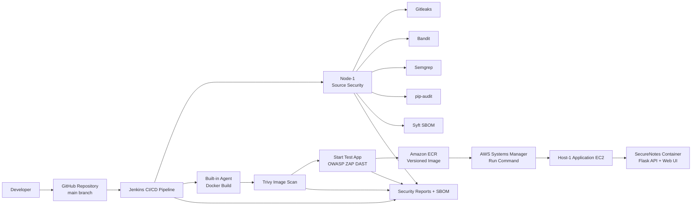

SecureNotes – End-to-End DevSecOps CI/CD Pipeline
A Flask-based notes application delivered through an automated DevSecOps pipeline using Jenkins, Docker, AWS EC2, Amazon ECR, and AWS Systems Manager. The pipeline combines source-code security checks, dependency analysis, SBOM generation, container scanning, dynamic application testing, image publishing, and automated deployment.
Project author: Parikshit Arer
Repository: ParikshitArer/DevSecOps-Project
AWS Region used in the captured implementation: Asia Pacific (Mumbai) – ap-south-1

Table of Contents
- Project Overview
- Application Features
- Architecture
- Technology Stack
- CI/CD Pipeline Stages
- Security Tools and Detection Coverage
- AWS Infrastructure
- Docker Image Design
- Deployment Flow
- Security Reports and Build Artifacts
- Observed Scan Results
- Security Considerations and Next Steps
- Accessing the Application
Project Overview
SecureNotes demonstrates how security can be incorporated into an application's delivery lifecycle rather than being performed only after deployment.

The source code is maintained in GitHub. Jenkins checks out the code and coordinates the pipeline. A dedicated Jenkins agent, Node-1, performs source-security checks. The Jenkins built-in agent handles Docker image creation, image scanning, application startup for DAST, publishing to Amazon ECR, and deployment orchestration. AWS Systems Manager (SSM) Run Command is used to initiate deployment on the application EC2 instance, avoiding a direct SSH-based deployment workflow.

The application is a Flask REST API with a browser-based interface for managing personal notes.
Application Features
- User registration and login using JWT-based authentication.
- Role-based authorization.
- Owner-scoped notes operations: create, read, update, and delete.
- Administrative endpoints for user management and application statistics.
- Password hashing.
- Environment-based application configuration.
- Security response headers and rate limiting.
- /healthz endpoint for application and container health checks.
- Browser interface served from /ui.
Main application routes
Route	Purpose
/	Application/API entry point
/healthz	Health check
/ui	SecureNotes browser interface
/api/auth/register	User registration
/api/auth/login	User login and authentication
/api/notes	User's notes collection
/api/notes/<id>	Operations on an individual note
/api/admin/users	Administrative user management
/api/admin/stats	Administrative application statistics

Administrative routes require the appropriate authorization. Do not expose administrative credentials or application secrets in source control.
Architecture
The following diagram represents the implemented delivery flow. Source-security checks run on Node-1; build, runtime scanning, publishing, and deployment orchestration run on the Jenkins built-in agent.

Technology Stack
Area	Technologies
Source control	Git, GitHub
CI/CD	Jenkins, Declarative Pipeline, multi-node agents
Application	Python 3.12, Flask, Gunicorn
Containerization	Docker, multi-stage Dockerfile
Secret detection	Gitleaks
Python SAST	Bandit
Rule-based SAST	Semgrep
Software Composition Analysis (SCA)	pip-audit
SBOM generation	Syft
Container vulnerability scanning	Trivy
Dynamic application security testing	OWASP ZAP
Cloud infrastructure	AWS VPC, EC2, IAM
Image registry	Amazon ECR
Remote deployment	AWS Systems Manager (SSM)
Reporting	JSON reports, HTML reports, Jenkins HTML Publisher

CI/CD Pipeline Stages
Stage	What happens	Execution location
1. Source checkout	Pulls application source from the GitHub main branch.	Node-1
2. Secret detection	Gitleaks checks Git content for rule-matched secrets.	Node-1
3. Python SAST	Bandit analyzes Python code for common insecure constructs.	Node-1
4. SAST	Semgrep runs configured security rules against source code.	Node-1
5. Dependency audit	pip-audit checks resolved Python dependencies against known advisories.	Node-1
6. SBOM generation	Syft inventories software components and versions.	Node-1
7. Docker build	Builds the multi-stage application image.	Jenkins built-in agent
8. Container scan	Trivy scans the image for known vulnerabilities.	Jenkins built-in agent
9. DAST	Starts the application and runs OWASP ZAP against the test instance.	Jenkins built-in agent
10. Image publishing	Tags and pushes the image to the private ECR repository.	Jenkins built-in agent
11. Deployment	Uses SSM Run Command to deploy the requested image on Host-1.	Jenkins built-in agent, with command executed on Host-1
12. Post-actions	Generates and publishes the consolidated HTML security report and scan artifacts.	Jenkins built-in agent

Security Tools and Detection Coverage
The tools identify different types of risk. Actual coverage depends on the rules, versions, scan options, application routes, and authentication available during a scan.
Tool	Security purpose	Examples of issues it can help identify
Gitleaks	Secret detection	Committed cloud keys, API tokens, passwords, private keys, and other rule-matched secret strings.
Bandit	Python SAST	Risky Python calls, unsafe shell execution patterns, unsafe deserialization patterns, weak cryptographic usage, disabled TLS verification, and hardcoded credential patterns.
Semgrep	Rule-based SAST	Rule-matched patterns for SQL injection, XSS, command injection, path traversal, SSRF, unsafe deserialization, and selected authentication or access-control weaknesses.
pip-audit	Python dependency/SCA scanning	Known security advisories affecting resolved direct and transitive Python packages included in the audit input.
Syft	Software Bill of Materials	Inventory of software components and versions in the scanned source, filesystem, or container image. Syft produces an inventory; it is not itself a CVE verdict.
Trivy	Container vulnerability scanning	Known CVEs in detected OS packages and language dependencies, including Python packages present in the image.
OWASP ZAP	Dynamic application security testing	Runtime HTTP issues supported by enabled rules, such as reflected XSS, selected injection tests, missing security headers, CSRF-related weaknesses, insecure cookie settings, and information disclosure.

Important coverage limitations
- A static-analysis result depends on the ruleset and the files actually scanned. SAST tools do not guarantee detection of every business-logic or authorization issue.
- pip-audit checks known package advisories; it does not inspect application logic.
- Syft inventories components but does not independently determine whether those components are vulnerable.
- Trivy image scanning is not the same as a full AWS, Terraform, Kubernetes, or Dockerfile configuration audit.
- ZAP can test only the routes and parameters it can reach and crawl. Authentication, API coverage, scan policy, and enabled add-ons affect results.
- The captured implementation does not show a dedicated AWS posture/IAM audit, infrastructure-as-code scan, full authenticated API authorization test, manual business-logic assessment, or runtime threat-detection system.
AWS Infrastructure
The captured environment uses the AWS Mumbai region (ap-south-1) and a dedicated VPC.
Resource	Captured configuration
VPC	DevSecOps-CI/CD, CIDR 10.0.0.0/16
Subnet-1	ap-south-1a, 10.0.1.0/24
Subnet-2	ap-south-1b, 10.0.2.0/24
Internet connectivity	Internet Gateway connected through the route table shown in the AWS resource map
Jenkins Master	EC2 instance shown as c7i-flex.large
Node-1	EC2 instance shown as c7i-flex.large
Host-1	Application EC2 instance shown as t3.micro
ECR repository	devsecops_repo

The submitted AWS console evidence showed all three EC2 instances in the Running state with 3/3 status checks passed at the time of capture. Instance status and public IP addresses can change, so verify the current AWS console before using these values operationally.
Docker Image Design
The application uses a multi-stage Dockerfile:
1. A python:3.12-slim builder stage installs Python dependencies into an isolated /install prefix.
2. A fresh python:3.12-slim runtime stage receives the installed dependencies and application files.
3. The runtime runs as a dedicated non-root account (appuser, UID 10001).
4. Application data is stored under /srv/data, with DATA_DIR=/srv/data configured in the container.
5. The container exposes port 5000 and runs Gunicorn with two workers.
6. A Docker health check calls http://127.0.0.1:5000/healthz.
The deployment configuration maps host port 80 to container port 5000 and mounts a host directory for persistent application data.
Deployment Flow
The captured deployment workflow is:
1. Jenkins authenticates to Amazon ECR and pushes a build-numbered image.
2. Jenkins invokes AWS Systems Manager Run Command for the application EC2 instance.
3. The remote deployment script authenticates to ECR and pulls the requested image tag.
4. The existing application container is replaced and the new container is started.
5. The application health check is used to verify container readiness.
This workflow uses SSM for remote command execution instead of relying on direct SSH deployment. Apply least-privilege IAM policies to the Jenkins identity and the application EC2 instance role. Prefer instance-role-based ECR pull access on the application host where possible, so registry credentials do not need to be handled by the deployment command.
Security Reports and Build Artifacts
The Jenkins job retains machine-readable scan outputs and human-readable reports. The captured build page listed artifacts including:
- bandit-report.json
- dependency-report.json
- gitleaks-report.json
- semgrep-report.json
- sbom.json
- trivy-report.json
- trivy-report.txt
- zap-report.html
- security-report.html
The consolidated HTML report is published through Jenkins HTML Publisher. Keep these artifacts access-controlled because security reports can contain sensitive paths, dependency details, and possible secret references.
Observed Scan Results
The following results are from the captured Jenkins build #105 on 26 November 2026. They are a snapshot of that run, not a statement about every later build.
Tool	Reported result
Gitleaks	2 findings, both Critical
Bandit	0 findings
Semgrep	0 findings
pip-audit	0 findings
Trivy	230 findings: 54 High, 81 Medium, 78 Low, 17 Informational
Syft	28 software components inventoried
OWASP ZAP	zap-report.html artifact exists; the consolidated report states that the HTML output was not parsed or included in its finding count

The consolidated report recorded 232 findings across Gitleaks and Trivy. The configured policy blocks High severity and above, resulting in 56 blocking findings: 2 Critical and 54 High.
Release-status distinction: Build #105 visibly completed the ECR image-push and application-EC2 deployment stages, but its consolidated security gate failed. The pipeline's scan stages were configured to allow downstream stages to continue when findings were marked unstable. Successful deployment therefore does not mean that the image passed the configured security policy.

Security Considerations and Next Steps
Prioritized improvements based on the captured build and implementation evidence:
1. Investigate the two Critical Gitleaks findings. Determine whether any credentials are active, rotate exposed credentials, remove them from the working tree, and address repository history where necessary.
2. Triage the 54 High Trivy findings. Update affected base packages and dependencies, rebuild the image, and document any approved exceptions with an owner and expiry.
3. Enforce the security gate before release. Critical/High findings should stop image publishing and deployment unless an explicit, audited exception is approved.
4. Include ZAP findings in consolidated reporting. Parse the ZAP output into the common report format and review the retained ZAP report directly.
5. Enable HTTPS. The captured browser session used HTTP and displayed a “Not secure” warning. Add TLS termination and enforce HTTPS before using real or sensitive user content.
6. Review IAM permissions. Apply least privilege and prefer an EC2 instance role for ECR image pulls.
7. Add release safeguards. Implement rollback, deployment audit logging, alerting, and repeatable post-deployment API tests.
8. Extend security coverage. Consider AWS configuration/IAM auditing, IaC scanning, authenticated API authorization tests, and manual business-logic testing.
Accessing the Application
The submitted screenshot showed the browser UI at the following address at the time of capture:
http://<EC2-PUBLIC-IP>/ui
The public IP may change. The captured application used HTTP, not HTTPS; do not use real or sensitive credentials until HTTPS is configured and verified.
Project Evidence
The implementation was documented using AWS console screenshots, Jenkins stage and build views, Dockerfile configuration, ECR image evidence, the SecureNotes UI, and the consolidated security report. These demonstrate the captured configuration and execution. They are not an independent penetration test or a guarantee that the application is free from vulnerabilities.

Built with a security-first delivery approach — Build. Secure. Deploy.
